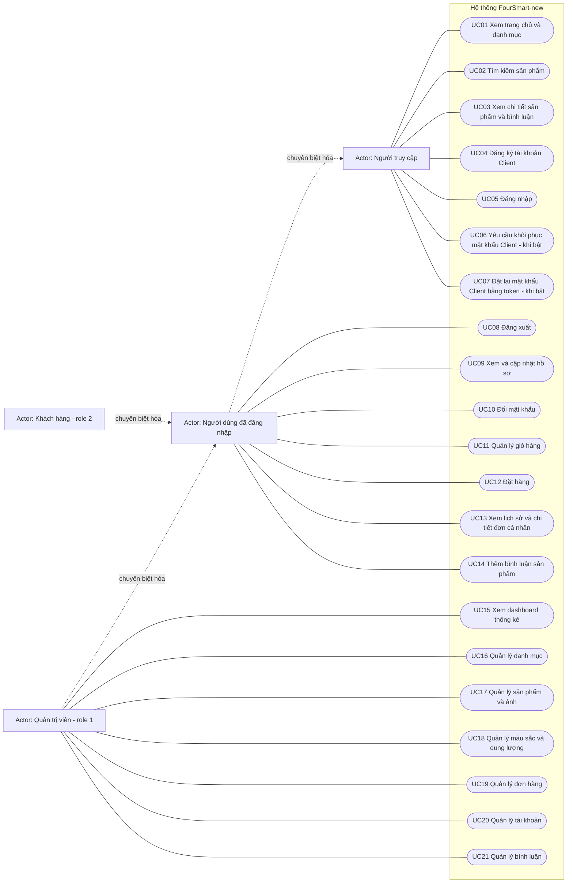

# Use Case FourSmart-new

Phân tích tĩnh từ mã nguồn trên nhánh `feature/foursmart-skill`. Chỉ mô tả chức năng đã có trong code; chưa xác nhận trạng thái vận hành của website/database hoặc cấu hình recovery.

## Actor và quyền

| Actor | Căn cứ trong mã |
| --- | --- |
| Người truy cập | Actor tổng quát, bao gồm khách chưa đăng nhập và người đã đăng nhập. Trang chủ, danh mục, tìm kiếm và chi tiết sản phẩm không yêu cầu session đăng nhập: [home_controller.php](../../mvc/controller/client/home_controller.php), [category_controller.php](../../mvc/controller/client/category_controller.php), [product_controller.php](../../mvc/controller/client/product_controller.php). |
| Người dùng đã đăng nhập | Có `user_id > 0` trong session. Giỏ hàng, đặt hàng, đơn cá nhân, hồ sơ và bình luận kiểm tra đăng nhập, không kiểm tra riêng `role_id=2`: [cart_controller.php](../../mvc/controller/client/cart_controller.php), [checkout_controller.php](../../mvc/controller/client/checkout_controller.php), [order_controller.php](../../mvc/controller/client/order_controller.php), [profile_controller.php](../../mvc/controller/client/profile_controller.php), [comment_controller.php](../../mvc/controller/client/comment_controller.php). |
| Khách hàng (Client) | Tài khoản role `2`, được tạo khi đăng ký. Có các quyền chung của người dùng đăng nhập: [ClientAuthController::register](../../mvc/controller/client/auth_controller.php). |
| Quản trị viên (Admin) | Có session đăng nhập và `role_id=1`; middleware được gọi trước khi điều phối mọi route admin: [require_admin.php](../../mvc/middleware/require_admin.php), [admin_controller.php](../../mvc/controller/admin/admin_controller.php). Admin cũng thỏa điều kiện của các route client chỉ yêu cầu đăng nhập. |

Khách chưa đăng nhập là trạng thái của Người truy cập, không phải bản ghi role trong database. Các actor tổng quát giúp tránh gán nhầm quyền chung thành quyền chỉ dành cho Client. Phiên đăng nhập còn được kiểm tra bởi [SessionGuard::enforce](../../mvc/core/SessionGuard.php) theo [SessionVersionPolicy](../../mvc/core/SessionVersionPolicy.php).

## Sơ đồ Mermaid

Dùng `flowchart` với nút dạng oval để biểu diễn Use Case bằng Mermaid. Đường liền biểu thị liên kết Actor–Use Case, không biểu thị thứ tự thực hiện. Mũi tên nét đứt có nhãn “chuyên biệt hóa” hướng từ actor cụ thể tới actor tổng quát; đây là quy ước mô phỏng quan hệ tổng quát hóa UML bằng flowchart.

Đăng nhập là điều kiện trước của UC08–UC14; middleware còn yêu cầu role admin cho UC15–UC21. Không dùng quan hệ `include` tới Đăng nhập vì các thao tác này không thực hiện lại việc đăng nhập mỗi lần. Các trang đăng nhập/đăng ký/recovery không có guard bắt buộc người gọi phải đang đăng xuất; sơ đồ phản ánh khả năng truy cập đó, không hàm ý admin được cấp token recovery.

## Giải thích chức năng và đối chiếu mã nguồn

Route client có dạng `?client=<action>`; route admin có dạng `?act=admin&admin=<action>`. Nguồn điều phối: [index.php](../../mvc/index.php), [ClientRouter::run](../../mvc/controller/client/client_controller.php), [AdminRouter::run](../../mvc/controller/admin/admin_controller.php).

| Use Case | Chức năng đã triển khai, điều kiện và route | Nguồn thực hiện |
| --- | --- | --- |
| UC01 | Xem sản phẩm/danh mục trên trang chủ; mở sản phẩm theo danh mục hợp lệ. Route `home`, `category`. | [ClientHomeController::handle](../../mvc/controller/client/home_controller.php), [ClientCategoryController::handle](../../mvc/controller/client/category_controller.php). |
| UC02 | Nhập từ khóa `q`, tìm sản phẩm theo tên hoặc mã bằng SQL `LIKE`. Route `productSearch`. | [ClientProductController::search](../../mvc/controller/client/product_controller.php), [ProductModel::search](../../mvc/model/ProductModel.php). |
| UC03 | Xem thông tin sản phẩm, danh sách màu/dung lượng và bình luận. Route `productDetail`. | [ClientProductController::detail](../../mvc/controller/client/product_controller.php). |
| UC04 | Đăng ký với username, mật khẩu, email, địa chỉ; kiểm tra dữ liệu/trùng tài khoản, băm mật khẩu và tạo role `2`. Route `register`. | [ClientAuthController::register](../../mvc/controller/client/auth_controller.php), [AccountModel::create](../../mvc/model/AccountModel.php). |
| UC05 | Xác minh thông tin đăng nhập, tạo lại session ID, lưu user/role và phiên bản phiên khi chính sách yêu cầu; điều hướng admin hoặc client. Route `login`. | [ClientAuthController::login](../../mvc/controller/client/auth_controller.php). |
| UC06 | Gửi yêu cầu bằng email hợp lệ, áp dụng rate limit và đưa vào hàng đợi; worker phát token/gửi thư khi tìm đúng một tài khoản Client role `2`. Route `forgotPassword`. Không tiết lộ sự tồn tại tài khoản qua phản hồi yêu cầu. | [ClientPasswordRecoveryController::handle](../../mvc/controller/client/password_recovery_controller.php), [PasswordRecoveryService::request](../../mvc/service/PasswordRecoveryService.php), [PasswordRecoveryModel::request và issue](../../mvc/model/PasswordRecoveryModel.php), [worker](../../mvc/cli/password_recovery_worker.php). |
| UC07 | Dùng token hợp lệ, chưa dùng và chưa hết hạn để đặt mật khẩu mới; kiểm tra xác nhận, tăng `session_version` và đánh dấu token đã dùng. Route `resetPassword`. | [ClientPasswordRecoveryController::handle](../../mvc/controller/client/password_recovery_controller.php), [PasswordRecoveryModel::reset](../../mvc/model/PasswordRecoveryModel.php). |
| UC08 | Xóa session và cookie đăng nhập, quay về trang đăng nhập. Route `logout`. | [ClientAuthController::logout](../../mvc/controller/client/auth_controller.php). |
| UC09 | Xem hồ sơ của mình và cập nhật email/địa chỉ sau kiểm tra hợp lệ, trùng email và CSRF. Route `profile`, `profileUpdate`. | [ClientProfileController::show và update](../../mvc/controller/client/profile_controller.php), [AccountModel::updateProfile](../../mvc/model/AccountModel.php). |
| UC10 | Nhập mật khẩu hiện tại, mật khẩu mới và xác nhận; kiểm tra độ mạnh, khác mật khẩu cũ, giới hạn nhập sai và cập nhật mật khẩu. Route `profilePasswordChange`. | [ClientProfileController::changePassword](../../mvc/controller/client/profile_controller.php), [AccountModel::changePassword](../../mvc/model/AccountModel.php). |
| UC11 | Xem/thêm dòng hàng theo màu và dung lượng, tăng/giảm số lượng, xóa dòng; kiểm tra tồn kho và quyền sở hữu. Route `cart`, `cartAdd`, `cartIncrease`, `cartDecrease`, `cartDelete`. | [ClientCartController](../../mvc/controller/client/cart_controller.php), [CartModel](../../mvc/model/CartModel.php). |
| UC12 | Với giỏ không rỗng, nhận thông tin giao hàng, tính tổng, kiểm tra tồn kho; transaction tạo đơn/chi tiết, giảm tồn và xóa chi tiết giỏ, rollback nếu có exception. Route `checkout`. | [ClientCheckoutController::handle](../../mvc/controller/client/checkout_controller.php), [CheckoutService::createOrder](../../mvc/service/CheckoutService.php). |
| UC13 | Xem lịch sử đơn và chi tiết đơn thuộc tài khoản hiện tại; không cho xem đơn của tài khoản khác. Route `orderHistory`, `orderDetail`. | [ClientOrderController::history và detail](../../mvc/controller/client/order_controller.php), [OrderModel](../../mvc/model/OrderModel.php). |
| UC14 | Gửi bình luận không rỗng cho sản phẩm tồn tại qua POST có CSRF; gắn tài khoản đang đăng nhập. Route `commentAdd`. | [ClientCommentController::handle](../../mvc/controller/client/comment_controller.php), [CommentModel::create](../../mvc/model/CommentModel.php). |
| UC15 | Xem tổng đơn, tổng doanh thu, doanh thu tháng trong năm hiện tại, số đơn theo trạng thái và top 5 sản phẩm theo lượng bán. Truy vấn doanh thu hiện cộng đơn của mọi trạng thái. Route admin `home`. | [AdminHomeController::handle](../../mvc/controller/admin/home_controller.php), [OrderModel](../../mvc/model/OrderModel.php). |
| UC16 | Liệt kê, thêm, sửa, xóa danh mục; chặn xóa danh mục đang có sản phẩm. Route `categoryList`, `categoryAdd`, `categoryUpdate`, `categoryDelete`. | [AdminCategoryController](../../mvc/controller/admin/category_controller.php), [CategoryModel::hasProducts](../../mvc/model/CategoryModel.php). |
| UC17 | Liệt kê, thêm, sửa, xóa sản phẩm; upload ảnh JPEG/PNG/WebP tối đa 5 MB; chặn xóa khi có dữ liệu liên quan theo kiểm tra model. Route `productList`, `productAdd`, `productUpdate`, `productDelete`. | [AdminProductController](../../mvc/controller/admin/product_controller.php), [ProductModel::hasRelatedData](../../mvc/model/ProductModel.php). |
| UC18 | Xem, thêm, sửa, xóa màu và dung lượng gắn với sản phẩm. Route `productVariant`, `productColorAdd/Update/Delete`, `productMemoryAdd/Update/Delete` (mỗi hậu tố là một action riêng). | [AdminProductVariantController](../../mvc/controller/admin/product_variant_controller.php), [ProductVariantModel](../../mvc/model/ProductVariantModel.php). |
| UC19 | Xem danh sách/chi tiết tất cả đơn; cập nhật trạng thái trong danh sách: Chờ xác nhận, Đã xác nhận, Đang giao, Đã giao, Đã hủy. Route `orderList`, `orderDetail`, `orderStatus`. | [AdminOrderController](../../mvc/controller/admin/order_controller.php). |
| UC20 | Liệt kê, sửa username/email/địa chỉ/vai trò, xóa tài khoản với kiểm tra dữ liệu liên quan và các điều kiện trong controller. Không có route admin tạo tài khoản riêng. Route `accountList`, `accountUpdate`, `accountDelete`. | [AdminAccountController](../../mvc/controller/admin/account_controller.php), [AccountModel](../../mvc/model/AccountModel.php). |
| UC21 | Xem danh sách bình luận kèm tài khoản/sản phẩm và xóa bình luận. Route `commentList`, `commentDelete`. | [AdminCommentController](../../mvc/controller/admin/comment_controller.php), [CommentModel](../../mvc/model/CommentModel.php). |

## Giới hạn và điều kiện

- UC06–UC07 đã có mã nhưng chỉ hoạt động khi recovery được bật và cấu hình hợp lệ. [PasswordRecoveryConfig::enabled/load](../../mvc/config/password_recovery.php) yêu cầu cờ `FOURSMART_PASSWORD_RECOVERY_ENABLED=1`, chính sách phiên phù hợp và cấu hình recovery. Không khẳng định môi trường hiện tại đã bật.
- Worker và mailer là thành phần thực thi bên trong luồng recovery, không phải vai trò người dùng; không bổ sung actor vận hành hay actor cổng thanh toán khi chưa có quyền/luồng tương ứng trong phạm vi sơ đồ.
- UC12 phản ánh đặt hàng; không suy ra thanh toán trực tuyến từ tên trang `pay.php`. UC19 phản ánh cập nhật trạng thái; không suy ra có quy trình hoàn tiền, hoàn tồn hoặc khách tự hủy đơn.
- Sơ đồ mô tả khả năng và quyền được kiểm tra trong mã, không phải chứng nhận mọi luồng đã được kiểm thử runtime. Chưa render bằng Mermaid CLI vì môi trường không có lệnh `mmdc`; đã kiểm tra cấu trúc sơ đồ và liên kết nguồn bằng phân tích tĩnh.
